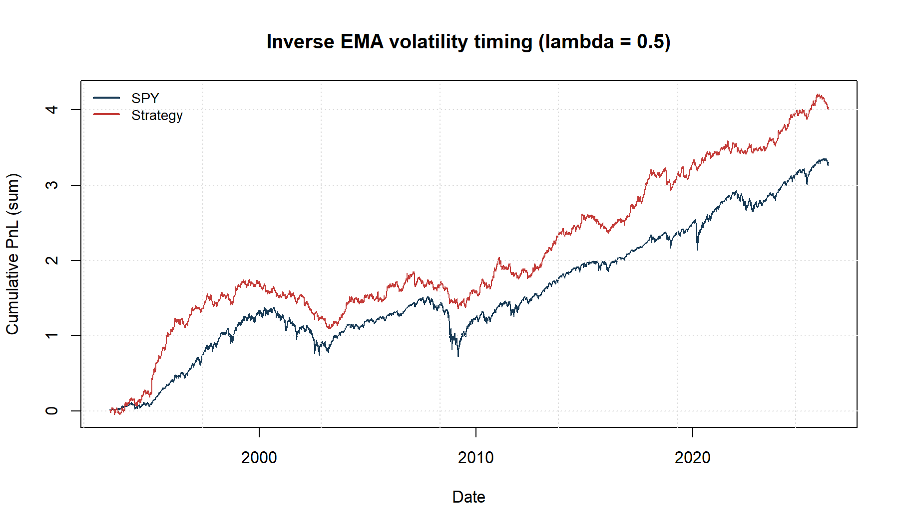
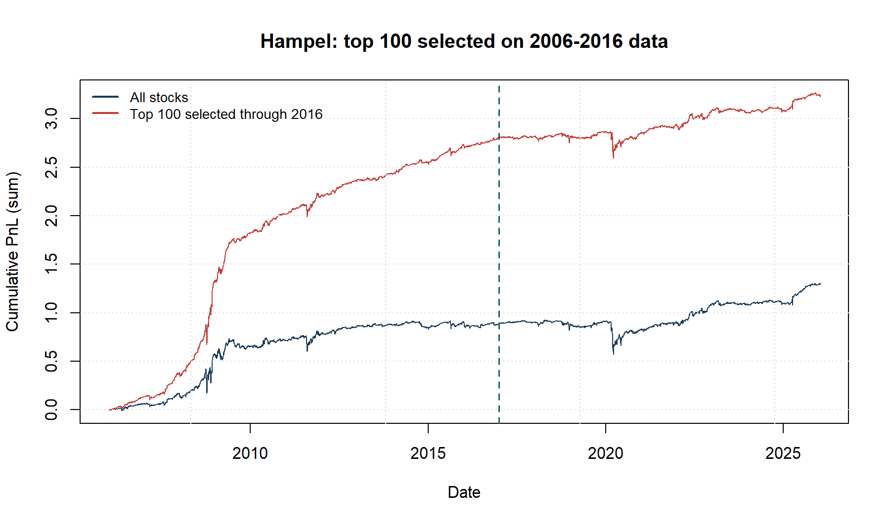

# FRE7241 Homework 2

**Panagiotis Housos | Algorithmic Portfolio Management | Fall 2026**

Inverse EMA volatility timing for SPY and a three-observation Hampel strategy
for individual stocks, with a parallel parameter sweep and a 2016 sample split.

**[PDF report](report/Panagiotis_Housos_HW2_Report.pdf)** |
[LaTeX source](report/Panagiotis_Housos_HW2_Report.tex) |
[Completed R submission](Panagiotis_Housos_hw2.R) |
[Independent checks](hw2_results/verification.txt)

## Results

- SPY Sharpe: **0.5360**; net volatility-timing Sharpe at lambda 0.5: **0.6548**.
- Best of nine tested decay factors: **lambda 0.3**, Sharpe **0.6833**.
- Hampel strategies: **717 stocks**; all-stock mean PnL Sharpe **0.5415**.
- Matched in/out-of-sample stocks: **645**; Sharpe correlation **0.0293**,
  regression slope p-value **0.4572**. This snapshot gives little evidence of
  the persistence illustrated by the template.
- The top 100 selected using only data through 2016 have an in-sample Sharpe
  of **2.1925** and a subsequent Sharpe of **0.4027**.





## Run the code

Clone the repository, including its `data/` folder. R and the required packages
are sufficient to run the completed assignment; building the report also
requires `pdflatex`.

```sh
Rscript --vanilla setup.R
Rscript --vanilla Panagiotis_Housos_hw2.R
```

The assignment uses a PSOCK cluster from `parallel`, including on Windows.
It saves four interactive dygraphs under `hw2_results/interactive/`, six PNG
and vector PDF figures, CSV tables, and an RDS result object. Open the HTML
files locally with their adjacent `lib/` folder. GitHub's file viewer does
not execute the charts' JavaScript.

Rebuild the report on Windows:

```powershell
powershell -ExecutionPolicy Bypass -File build.ps1
```

Use `-SkipAnalysis` to keep the existing analysis outputs while verifying and
compiling the report. Equivalent commands, from the repository root:

```sh
Rscript --vanilla reproducibility/verify_hw2.R
Rscript --vanilla report/export_results.R
Rscript --vanilla reproducibility/record_environment.R
cd report
pdflatex -interaction=nonstopmode -halt-on-error Panagiotis_Housos_HW2_Report.tex
pdflatex -interaction=nonstopmode -halt-on-error Panagiotis_Housos_HW2_Report.tex
```

The recorded environment uses R 4.6.1, `rutils` 0.2, and `HighFreq` 0.1.
`setup.R` retains matching installations and installs the pinned course GitHub
commits when needed. Environment records include transitive package versions
and input fingerprints. No credentials or private R session files are needed.

## Data and interpretation

The frozen SPY sample has **8,352** returns from 1993-02-01 through 2026-04-07.
The supplied stock matrix has **5,042** dates from 2006-01-03 through
2026-01-16 and **717** columns. The template illustrates a different dataset,
so its sample counts and example values differ. See [data provenance](data/README.md).
The code uses actual calculations throughout.

- All Sharpe ratios use 252 trading days and zero risk-free return. The course
  Sortino uses the standard deviation of negative returns, rather than the
  usual downside semideviation.
- Part I deducts half the bid-ask spread times absolute position turnover,
  then matches net strategy volatility to SPY using a full-sample scalar.
  This scaling and the lambda selection are descriptive in-sample comparisons.
  The installed EMA initializes its first variance using the first two returns;
  the report explicitly identifies the resulting second-observation exception
  to fully causal initialization. Later positions use delayed recursive inputs.
- Hampel positions use log prices, a trailing median and scaled MAD, threshold
  crossings beyond +/-1, persistent holdings between crossings, and a one-day
  delay. Part II excludes transaction and short-borrow costs.
- Means align individual-stock PnLs by calendar date and average available
  stocks. The number of included names changes with available histories.
- In-sample means through December 2016; out-of-sample starts January 2017.
  Top-100 selection uses all finite in-sample ratios, including stocks that
  subsequently disappear, with no out-of-sample availability filter. The
  persistence regression separately requires finite ratios in both periods.
- Plots show cumulative sums of PnLs, not compounded wealth. The supplied
  universe does not establish historical membership or delisted-stock coverage;
  stock selection and survivorship may affect results. Sparse subperiod
  histories can also produce unstable Sharpe estimates.

## Files

| Location | Contents |
| --- | --- |
| `Panagiotis_Housos_hw2.R` | Completed solutions for all six tasks |
| `FRE7241_hw2.R`, root `strat_*.png` | Original assignment and reference figures |
| `report/` | Compiled PDF, LaTeX source, exported tables, vector figures |
| `hw2_results/` | Computed figures, interactive charts, CSV/RDS outputs, verification |
| `data/` | Frozen inputs and provenance notes |
| `reproducibility/` | Independent verifier, package/data records, course-review inventories |
| `setup.R`, `build.ps1` | Package setup and report build |

Course-review inventories summarize the local materials reviewed before the
analysis. The repository contains the Homework 2 submission and its supporting
artifacts; the course's textbooks, lecture PDFs, unrelated assignments, and
private environment files are not part of this submission.
